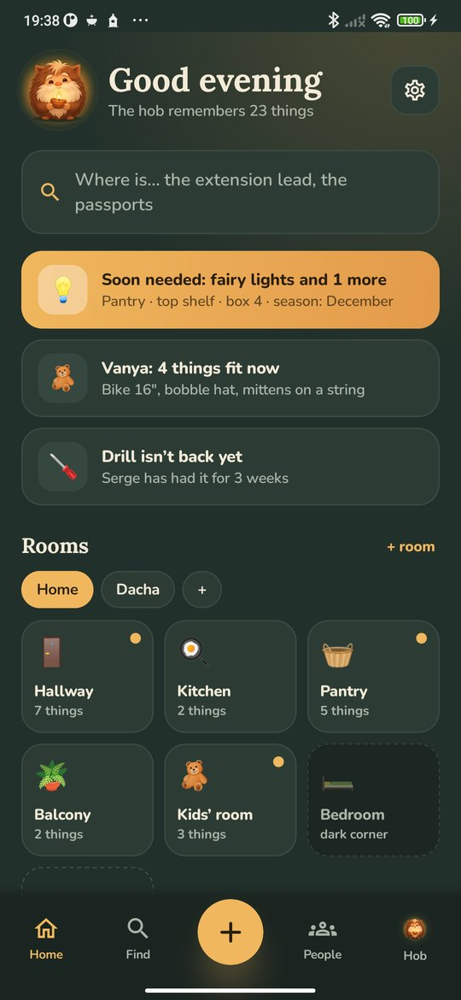
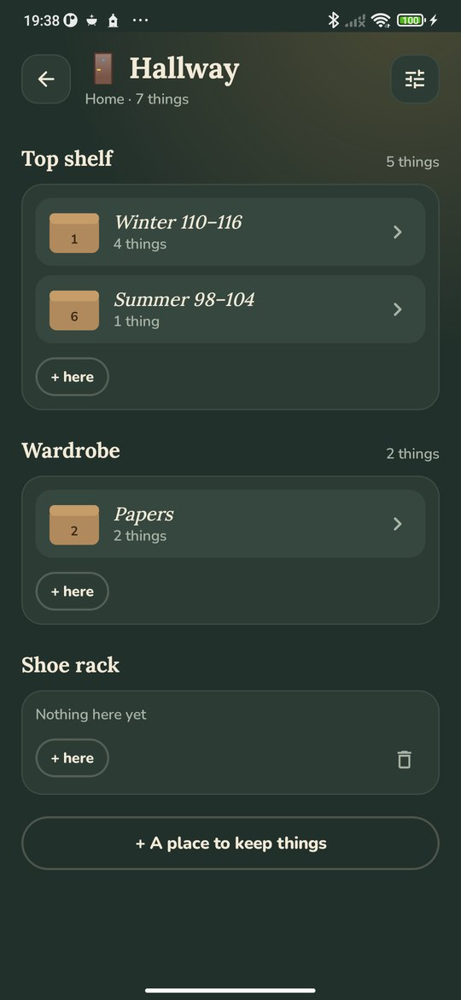
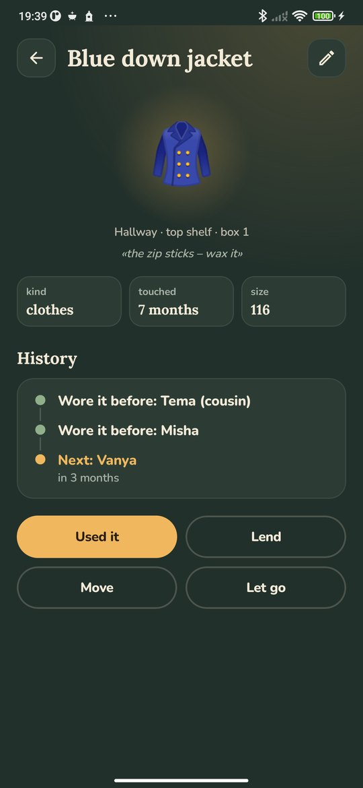
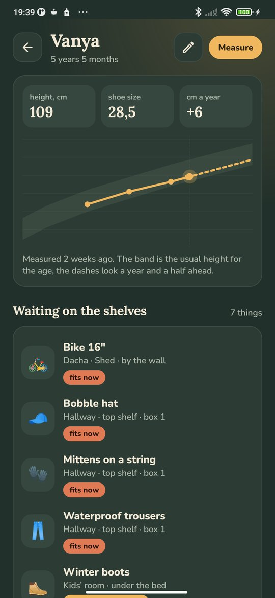

<div align="center">


# Hob

### Remembers where everything lies

*The extension lead, the passports, the tree decorations, the winter boots waiting for the younger one: write a thing down once, and the hob tells you where it is. He reminds you what's lent and overdue, what a child has grown into and what's gathering dust. Free, no ads, no account, works offline.*

[](https://github.com/bigdevwhale/hob/actions/workflows/android.yml)
[](https://github.com/bigdevwhale/hob/releases/latest)


[](LICENSE)

**English** · [Русский](README.ru.md) · [Changelog](CHANGELOG.md)

   

**[Download APK](https://github.com/bigdevwhale/hob/releases/latest/download/Hob.apk)** · Android 9+

</div>

---

*A hob is the house spirit of English folklore; in Russian he is the domovoi, who lives behind the stove and keeps the house in order.*

## Your house

- **Places and rooms.** The flat, the dacha, the garage, gran's house – each place has its own rooms. You choose the names, the signs and the places to keep things: the top shelf, the wardrobe, under the bed.
- **Numbered boxes.** Write the number on the box with a marker, and the hob remembers what's inside and where it stands.
- **Dark corners.** A room with nothing written down stays dark. Open the cupboards, write down what's there, and it lights up.

## Where is it?

Ask the hob: "extension lead", "skates", "fairy lights". He searches names, rooms, places, box labels and numbers and tells you where to look: "Pantry · shelving · box 3". Browse by kind too – clothes, tools, papers, holidays – or make kinds of your own.

A name is enough to write a thing down: the hob picks the sign and the kind from it. A photo can be added, taken by the phone's own camera.

## The hob's notes

On the home screen the hob says what matters now:

- **Soon needed:** the tree decorations in December, the tent before summer. A thing can be marked with the month it's needed.
- **Not back yet:** the drill Serge borrowed. One tap sends a reminder through any messenger.
- **Time to give back:** the neighbour's step-ladder has been here two months.
- **Fits now:** things a child has grown into.

Once a day, at about half past ten in the morning, one notification – only when there's news.

## Growing into things

Add the children with their height and shoe size. A thing's size comes from its label: "116", "110–116", "4–5 y" or "30–33". The hob works out when a child grows into it, from their own pace once measured twice, or the usual one for their age. A thing keeps its history: who wore it before and who comes next. When a child outgrows it, it goes back on a shelf for the next one.

## Clear-out

Things untouched for over a year come one at a time: keep, give away, sell or throw out. Papers, seasonal things and clothes to grow into are left alone. In doubt, keep it – the hob asks again next year. After a clear-out, it's the custom to leave him some milk.

## The cosier the better

The hob likes lit rooms, clean shelves, things that come back and fresh measurements. Together they make the cosiness, and his title grows with it: guest, lodger, master, old-timer. There are signs for the first boxes, the first clear-out, a thing worn by two children. The hob's tab also shows what has gone on and what it brought in.

## Also

- **Evening and day.** A dark theme in warm lamp light, and a light one with the curtains open.
- **A copy of the house.** Every thing, room and photo in one file, to keep or to open on another phone. A CSV table too.
- **Offline.** No internet permission; everything stays on the phone.
- English and Russian.

## Build

JDK 17+ (Android Studio's bundled JBR works) and the Android SDK.

```bash
git clone https://github.com/bigdevwhale/hob.git
cd hob
./gradlew testDebugUnitTest assembleDebug   # app.hob.dev
./gradlew assembleDebug -Pdemo              # app.hob.demo: a lived-in flat and dacha
./gradlew testDebugUnitTest -Prender        # screens drawn to app/build/art
python tools/res.py                         # EN and RU strings from one table
```

Kotlin, Jetpack Compose, Room, DataStore.

## Feedback

Settings has buttons to report a bug or suggest an idea through the StillCraft bot on Telegram.

## License

MIT. Fonts: Lora (Cyreal) and Nunito (Vernon Adams), SIL Open Font License. Hob is part of [StillCraft](https://bigdevwhale.github.io/stillcraft/), a shelf of small free apps.
