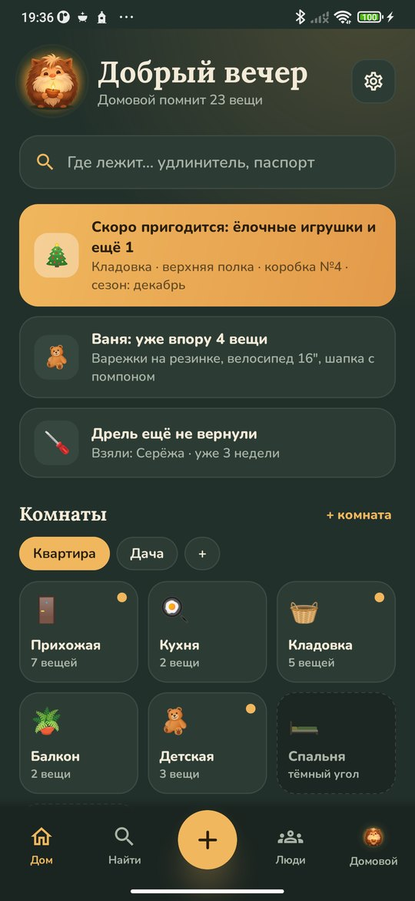
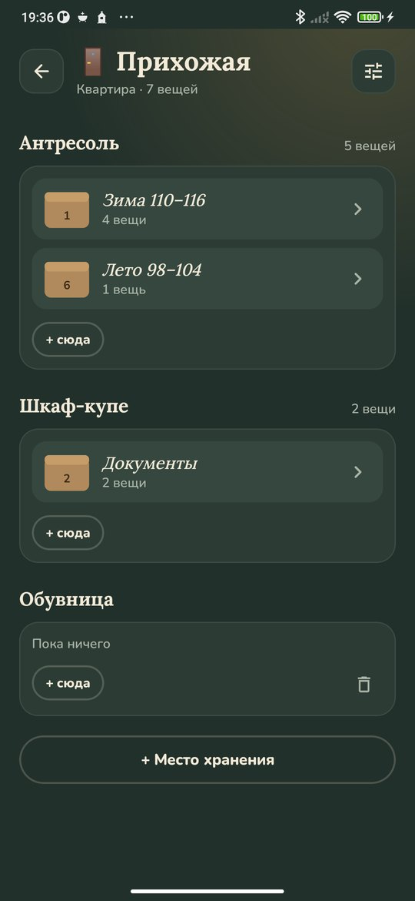
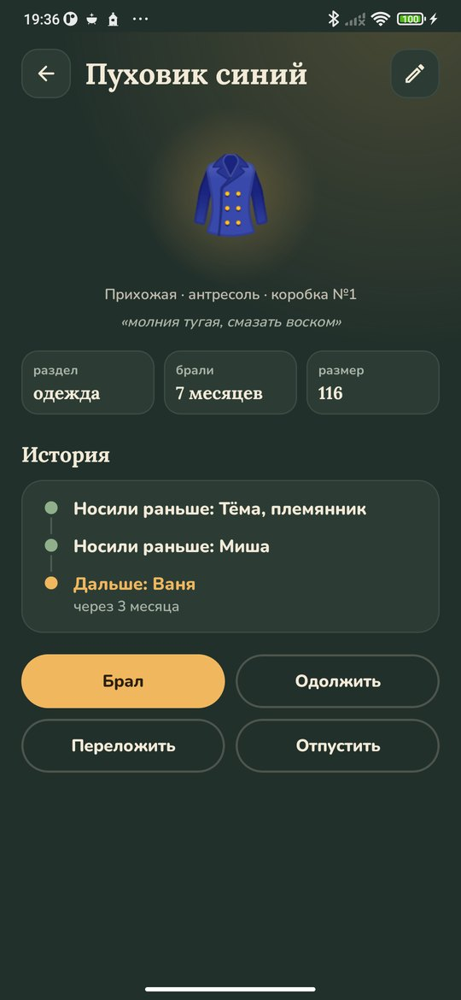
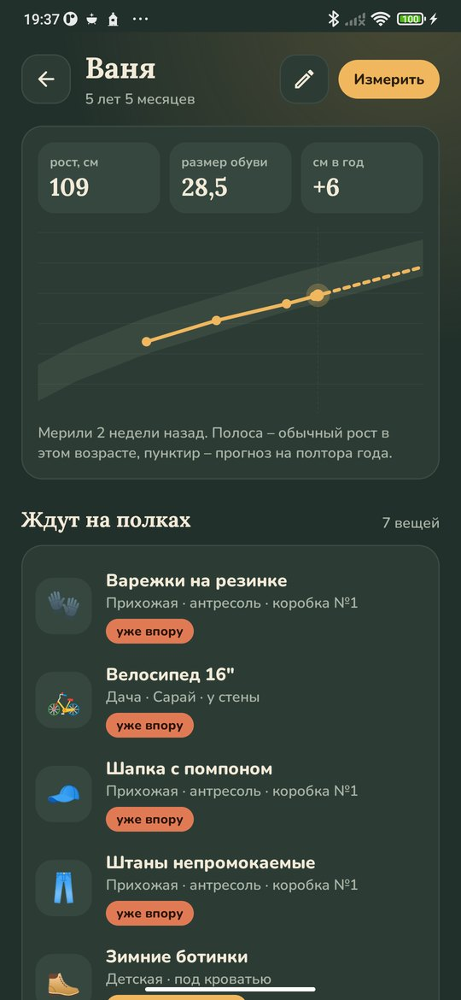

<div align="center">


# Домовой

### Помнит, где что лежит

*Удлинитель, паспорта, ёлочные игрушки, зимние ботинки, которые ждут младшего, – запишите вещь один раз, и домовой подскажет, где она. Он напомнит, что пора вернуть одолженное, что ребёнку уже впору и что пылится без дела. Бесплатно, без рекламы и регистрации, работает без интернета.*

[](https://github.com/bigdevwhale/hob/actions/workflows/android.yml)
[](https://github.com/bigdevwhale/hob/releases/latest)


[](LICENSE)

[English](README.md) · **Русский** · [Изменения](CHANGELOG.md)

   

**[Скачать APK](https://github.com/bigdevwhale/hob/releases/latest/download/Hob.apk)** · Android 9+

</div>

---

## Ваш дом

- **Адреса и комнаты.** Квартира, дача, гараж, бабушкин дом – у каждого адреса свои комнаты. Названия, значки и места хранения задаёте вы: антресоль, шкаф-купе, верхняя полка, под кроватью.
- **Коробки с номерами.** Напишите номер на коробке маркером, и домовой будет помнить, что в ней и где она стоит.
- **Тёмные углы.** Комната, где ещё ничего не записано, остаётся тёмной. Откройте шкафы, запишите, что там лежит, и в ней станет светло.

## Где лежит?

Спросите домового: «удлинитель», «коньки», «гирлянда». Он ищет по названию, комнате, месту, надписи на коробке и её номеру и сразу говорит, где искать: «Кладовка · стеллаж · коробка №3». Вещи можно смотреть и по разделам: одежда, инструменты, документы, праздники. Свои разделы тоже можно завести.

Чтобы записать вещь, хватит названия: значок и раздел домовой подберёт сам. Можно добавить фото – его снимает обычная камера телефона.

## Заметки домового

На главном экране домовой пишет, что важно сейчас:

- **Скоро пригодится:** ёлочные игрушки в декабре, палатка к лету. У вещи можно отметить месяц, когда она нужна.
- **Ещё не вернули:** дрель, которую взял Серёжа. Напомнить можно одной кнопкой – сообщение уйдёт через любой мессенджер.
- **Пора вернуть своё:** стремянка соседа живёт у вас уже два месяца.
- **Ребёнку уже впору:** вещи на вырост, которые ждали своего часа.

Раз в день, около половины одиннадцатого утра, домовой присылает одно уведомление, и только если есть что-то новое.

## Вещи на вырост

Добавьте детей и их мерки: рост и размер обуви. Размер вещи берётся с бирки – «116», «110–116», «4–5 лет» или «30–33». Домовой считает, когда ребёнок дорастёт, по его собственному темпу роста или по обычному для возраста, если мерили только раз. У вещи остаётся история: кто носил её раньше и кто будет носить дальше. Когда ребёнок вырос, вещь отправляется обратно на полку и ждёт следующего.

## Разбор

То, что не трогали больше года, домовой предлагает разобрать по одной вещи: оставить, отдать, продать или выбросить. Документы, сезонные вещи и одежда на вырост в разбор не попадают. Сомневаетесь – оставьте, домовой спросит снова через год. После разбора принято оставить ему молока.

## Чем уютнее, тем лучше

Домовой любит светлые комнаты, полки без паутины, вещи, которые возвращаются, и свежие мерки. Из этого складывается уют, а с ним растёт и его звание: гость, жилец, хозяин, старожил. Есть знаки за первые коробки, первый разбор и вещь, которую носили двое детей. Внизу вкладки «Домовой» видно, что ушло дальше и сколько удалось выручить.

## Ещё

- **Вечер и день.** Тёмная тема с тёплым светом лампы и светлая, как днём при открытых шторах.
- **Копия дома.** Все вещи, комнаты и фотографии в одном файле: сохранить на память или открыть на другом телефоне. Есть таблица CSV для Excel.
- **Без интернета.** У приложения нет доступа в сеть, всё хранится только на телефоне.
- Русский и английский.

## Сборка

Нужны JDK 17+ (подойдёт JBR из Android Studio) и Android SDK.

```bash
git clone https://github.com/bigdevwhale/hob.git
cd hob
./gradlew testDebugUnitTest assembleDebug   # app.hob.dev
./gradlew assembleDebug -Pdemo              # app.hob.demo: обжитая квартира и дача
./gradlew testDebugUnitTest -Prender        # экраны в app/build/art
python tools/res.py                         # строки EN и RU из одной таблицы
```

Kotlin, Jetpack Compose, Room, DataStore.

## Обратная связь

В настройках есть кнопки «Сообщить об ошибке» и «Предложить идею», они ведут к боту StillCraft в Telegram.

## Лицензия

MIT. Шрифты Lora (Cyreal) и Nunito (Vernon Adams), SIL Open Font License. Домовой входит в [StillCraft](https://bigdevwhale.github.io/stillcraft/) – полку небольших бесплатных приложений.
